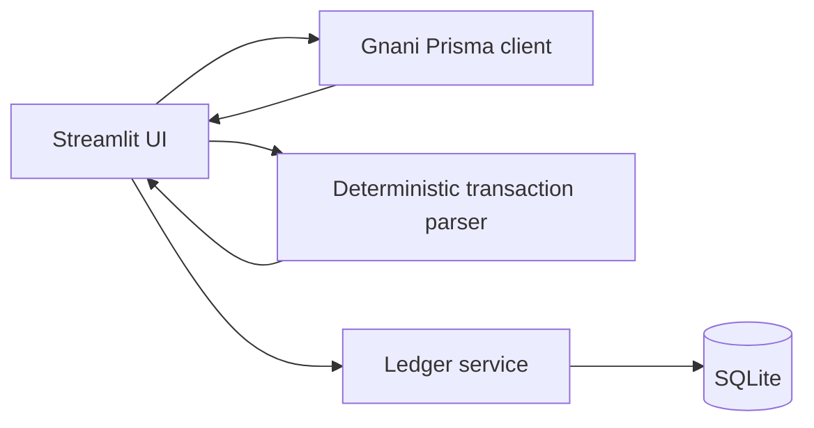

# BolKhata Trust

BolKhata Trust is a voice-first digital credit ledger for Indian kirana shops.
It uses Gnani Prisma to turn a Hindi, Marathi, or Hinglish voice note into a
reviewable transaction. The shopkeeper confirms the extracted customer, amount,
and type before anything is written to the ledger.

## What is working

- SQLite ledger with customer balances stored as integer paise.
- Thread-safe Streamlit database lifecycle: no live SQLite connection is cached
  across reruns; each operation gets a short-lived connection with rollback and
  cleanup.
- Hindi numeric and amount-word parsing, including credit and repayment examples.
- Gnani Prisma v3 transcription through the documented `X-API-Key-ID` header.
- A local browser component that keeps the microphone open, detects silence
  boundaries, encodes each utterance as real 16 kHz mono WAV, queues utterances
  in order, and pauses delivery until each transaction is confirmed or rejected.
- Confirmation-before-save flow in Streamlit.
- Searchable customers and transactions.
- Reversal records for corrections; the original row is never silently deleted.
- Idempotency keys to avoid duplicate voice submissions.
- Automated tests that never call Prisma or spend credits.

## Windows setup

```powershell
py -3.13 -m venv .venv
.\.venv\Scripts\python.exe -m pip install -r requirements.txt
Copy-Item .env.example .env
```

Put the real `GNANI_API_KEY` only in the local `.env` file. Never paste the key
into chat, source code, screenshots, logs, or Git.

Run the app:

```powershell
.\.venv\Scripts\python.exe -m streamlit run app.py
```

Run tests:

```powershell
.\.venv\Scripts\python.exe -m pytest -q
```

Build the continuous voice component after installing Node.js. Streamlit serves
`voice_component_frontend/dist`, so rebuild after any change under `src/`:

```powershell
Set-Location voice_component_frontend
npm ci
npm test
npm run build
Set-Location ..
```

Optional real-browser test (headless Chromium, fake microphone, mocked Gnani — no
API key and no credits are used):

```powershell
.\.venv\Scripts\python.exe -m pip install playwright
.\.venv\Scripts\python.exe -m playwright install chromium
$env:BOLKHATA_E2E = "1"
.\.venv\Scripts\python.exe -m pytest tests\e2e -q
```

The database is the existing root-level `bolkhata.sqlite3`, resolved by
`bolkhata/config.py` regardless of the launch directory. It is intentionally
ignored by Git. Set `BOLKHATA_DB` to use another local path.

## Project structure

```text
app.py                         Streamlit entry point
bolkhata/                      Application package
  config.py                    Root paths and environment loading
  database.py                  SQLite lifecycle and schema
  ledger.py                    Ledger operations and balances
  transaction_parser.py       Deterministic transcript parsing
  prisma_client.py             Server-side Gnani API client
  voice_component.py           Streamlit component bridge
  ui/                          Page renderers and styles
voice_component_frontend/      Browser microphone component (AudioWorklet PCM capture)
  src/segmenter.js             Silence/utterance segmentation (pure, unit-tested)
  src/queue.js                 One-in-flight queue with explicit acknowledgement
  src/audio.js                 Downsampling and WAV encoding
bolkhata/voice_workflow.py     Confirm / reject / acknowledge state machine (unit-tested)
scripts/smoke_test_prisma.py   Deliberate live API smoke test
tests/                         Unit, persistence, threading, and protocol tests
```

## Voice flow

1. Open **Voice Entry** and click **Start Listening** once. Upload remains a
   fallback.
2. Speak one utterance and pause. The component converts the browser recording
   to 16 kHz mono WAV and submits one completed segment to Prisma.
3. Review or edit the extracted fields, then click **Confirm and save** or
   **Reject and continue**. Listening resumes without another Start click.
4. Click **Stop Listening** when finished. No transaction is saved before
   confirmation.

The continuous component runs in the browser while the tab remains open. It
captures raw microphone audio with an `AudioWorklet`, downsamples it to 16 kHz
mono and segments it locally: a segment starts only when speech is detected,
ends after about 0.9 seconds of silence, discards clicks shorter than 0.25
seconds, and is force-split at 25 seconds (the documented Gnani limit is 30
seconds, also enforced server-side). Each segment is encoded as a real PCM WAV
file in the browser, so no codec conversion is needed. Segments are sent one at
a time; the browser releases the next one only when Python acknowledges the
current event, which happens after the transaction is saved (database commit
succeeded), rejected, or failed. Segments spoken during review wait in a queue
of up to three. Each utterance has a stable idempotency key (`voice:<event id>`),
so it can be saved at most once. The backend alone calls Prisma, so the API key
never reaches browser JavaScript. Use Chrome or Edge (`AudioWorklet` +
`getUserMedia`, served from `localhost` or HTTPS). The manual upload path
remains available, including WEBM files, which are converted to WAV with
`ffmpeg` (a hard 30 second timeout; install ffmpeg to use WEBM uploads).

Supported examples:

- `रमेश के खाते में 70 रुपये उधार लिख दो।`
- `मीना ने 50 रुपये वापस दिए।`
- `Ramesh ke account mein 70 rupaye udhaar likh do.`

The parser is intentionally conservative. If amount, customer, or transaction
type is unclear, it asks for manual correction rather than guessing.

## Architecture



## Privacy and limitations

This is a local MVP, not production-grade authentication or a public customer
portal. It does not claim to prevent fraud or guarantee speech recognition.
Do not use it with real customer data until access control, backups, retention,
and privacy obligations have been reviewed. Real recordings, `.env`, generated
results, and the local database are excluded from Git by default.

The Prisma smoke test remains separate for deliberate manual API testing and is
never run by pytest:

```powershell
.\.venv\Scripts\python.exe scripts\smoke_test_prisma.py recordings\test1.m4a --lang hi-IN,en-IN
```

## Demo checklist

1. Run the tests and start Streamlit.
2. Add a synthetic customer such as Ramesh.
3. Upload a prepared synthetic Hindi recording.
4. Show the transcript and edit/confirm the proposed ₹70 credit.
5. Show the balance on Dashboard and the customer ledger.
6. Add a repayment and show the balance decrease.
7. Reverse one synthetic transaction to demonstrate the audit trail.

Observed Prisma response and programme-credit figures are machine/account
specific and should not be presented as universal pricing or benchmark claims.
Verify current competition requirements and API documentation from Gnani's
official resources before submission.
