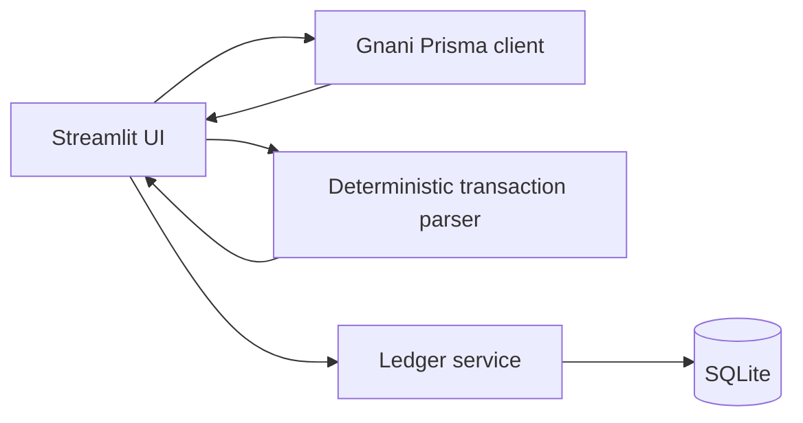

# BolKhata Trust

BolKhata Trust is a voice-first digital credit ledger for Indian kirana shops.
It uses Gnani Prisma to turn a Hindi, Marathi, or Hinglish voice note into a
reviewable transaction. The shopkeeper confirms the extracted customer, amount,
and type before anything is written to the ledger.

## What is working

- SQLite ledger with customer balances stored as integer paise.
- Thread-safe Streamlit database lifecycle: no live SQLite connection is cached
  across reruns; each operation gets a short-lived connection with rollback and
  cleanup.
- Hindi numeric and amount-word parsing, including credit and repayment examples.
- Gnani Prisma v3 transcription through the documented `X-API-Key-ID` header.
- A local browser component that keeps the microphone open, detects silence
  boundaries, queues utterances in order, and pauses delivery until each
  transaction is confirmed or rejected.
- Confirmation-before-save flow in Streamlit.
- Searchable customers and transactions.
- Reversal records for corrections; the original row is never silently deleted.
- Idempotency keys to avoid duplicate voice submissions.
- Automated tests that never call Prisma or spend credits.

## Windows setup

```powershell
py -3.13 -m venv .venv
.\.venv\Scripts\python.exe -m pip install -r requirements.txt
Copy-Item .env.example .env
```

Put the real `GNANI_API_KEY` only in the local `.env` file. Never paste the key
into chat, source code, screenshots, logs, or Git.

Run the app:

```powershell
.\.venv\Scripts\python.exe -m streamlit run app.py
```

Run tests:

```powershell
.\.venv\Scripts\python.exe -m pytest -q
```

The database is created as `bolkhata.sqlite3` and is intentionally ignored by
Git. Set `BOLKHATA_DB` to use another local path.

## Voice flow

1. Open **Voice Entry** and use **Record a transaction** when browser-native
   `st.audio_input` is available. Upload remains a fallback.
2. Click **Transcribe with Gnani Prisma**. This is the only UI action that
   sends a paid request.
3. Review or edit the extracted fields.
4. Click **Confirm and save**.

The continuous component runs in the browser while the tab remains open. It
uses `MediaRecorder` and local RMS silence detection (0.7–10 second segments,
approximately 0.9 seconds of silence). Completed segments are sent one at a
time to Python; later segments stay queued until the current transaction is
confirmed or rejected. The backend alone calls Prisma, so the API key never
reaches browser JavaScript. Chrome/Edge are recommended; browsers without
`getUserMedia` or `MediaRecorder` receive an explicit unsupported-browser
state. The manual upload path remains available, including WEBM files produced
by browser MediaRecorder.

Supported examples:

- `रमेश के खाते में 70 रुपये उधार लिख दो।`
- `मीना ने 50 रुपये वापस दिए।`
- `Ramesh ke account mein 70 rupaye udhaar likh do.`

The parser is intentionally conservative. If amount, customer, or transaction
type is unclear, it asks for manual correction rather than guessing.

## Architecture



## Privacy and limitations

This is a local MVP, not production-grade authentication or a public customer
portal. It does not claim to prevent fraud or guarantee speech recognition.
Do not use it with real customer data until access control, backups, retention,
and privacy obligations have been reviewed. Real recordings, `.env`, generated
results, and the local database are excluded from Git by default.

The Prisma smoke test remains separate for deliberate manual API testing:

```powershell
.\.venv\Scripts\python.exe smoke_test_prisma.py recordings\test1.m4a --lang hi-IN,en-IN
```

## Demo checklist

1. Run the tests and start Streamlit.
2. Add a synthetic customer such as Ramesh.
3. Upload a prepared synthetic Hindi recording.
4. Show the transcript and edit/confirm the proposed ₹70 credit.
5. Show the balance on Dashboard and the customer ledger.
6. Add a repayment and show the balance decrease.
7. Reverse one synthetic transaction to demonstrate the audit trail.

Observed Prisma response and programme-credit figures are machine/account
specific and should not be presented as universal pricing or benchmark claims.
Verify current competition requirements and API documentation from Gnani's
official resources before submission.
